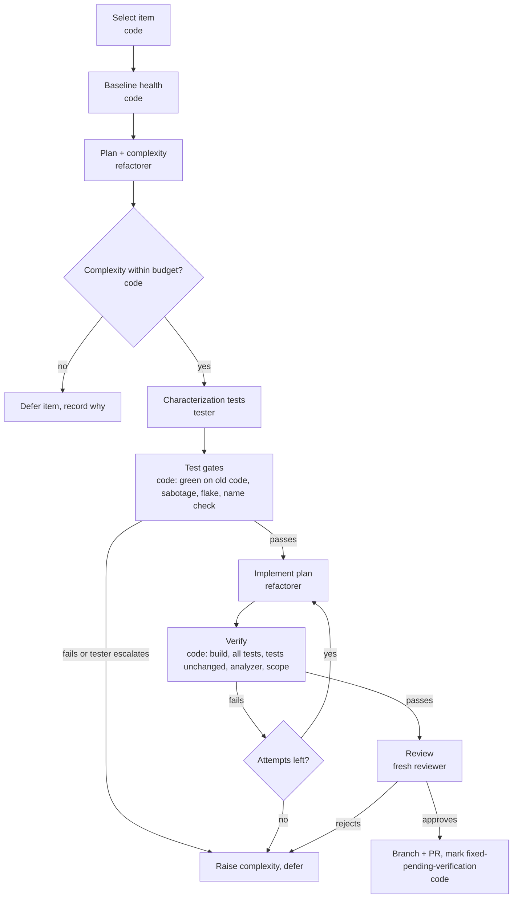

# Quality harness, fix phase: design

Status: design; iteration 1 (dry run) in progress. The second phase of the quality harness, alongside the analysis phase ([DESIGN.md](DESIGN.md)). It reads the register the analysis phase maintains (DESIGN.md, section 7) and shares the harness's agent wrapper, git, validation, register store, and config. Fix-specific code lives in `src/fix/`, with its prompts and schemas prefixed `fix-` in `prompts/` and `schemas/`. It runs as `npm run quality -- fix --repo <path>`.

The analysis phase finds and confirms SOLID debt and records it in the register. The fix phase takes one register item at a time and resolves it with a behavior-preserving refactoring, protected by tests written before the change. Two specialist agents do the work: a **refactorer** that plans and implements the change, and a **legacy-code tester** that builds the safety net. They are fully separated: the refactorer has no responsibility for tests and never sees them. Code orchestrates, gates, and verifies; agents only do work that needs judgment.

## 1. Principles

1. **Behavior is preserved, and that is proven, not assumed.** Every change is a refactoring in Fowler's sense: same observable behavior, better structure. The tester pins current behavior before any production code changes, and those tests must pass unchanged afterwards.
2. **Small and boring first.** Only the lowest complexity level is attempted until the pipeline proves itself (section 6). Complexity is raised by evidence, never lowered by an agent.
3. **Separation of duties, including information.** Tests are entirely the tester's responsibility. The refactorer never writes, reads, chooses, or runs tests: its read tools cannot open test projects, it has no test-run tool, and its plan says nothing about testing. This avoids two problems: bias (a refactorer that sees the tests can shape the change to pass them rather than to preserve behavior) and context bloat (test code in the refactorer's context it does not need). The tester never edits production code. A fresh reviewer checks the result. No agent judges its own work.
4. **The analyzer is the referee for "resolved", not the refactorer.** A fix counts only when the finding disappears (or drops to the planned severity) without new findings on the touched types, and the next analysis run confirms it.
5. **Feathers' legacy code change algorithm, mechanized:** identify change points, find test points, break dependencies (only where the plan allows), write tests, make changes and refactor.

## 2. Flow



| # | Step | Who | Output |
|---|---|---|---|
| 0 | **Select.** Read `.tech-debt/items/` on the base branch. Pick `open`/`reopened` items, metric findings first (they can be re-checked deterministically), highest severity first, skipping items deferred at the current budget. `claim` the item | code | `fix-runs/<run-id>/manifest.json` |
| 1 | **Baseline health.** In a fresh worktree at the base commit: build the solution or the configured projects, run every configured test project, re-run the analyzer and confirm the finding is still present. Record pre-existing test failures as the baseline; they never block a fix, new failures always do | code | `baseline.json` |
| 2 | **Plan.** The refactorer writes a plan with a complexity rating (section 4) | refactorer | `plan.json` |
| 3 | **Gate.** Complexity is the higher of the refactorer's rating and the code-computed floor. Above budget: defer, release the claim, record why | code | |
| 4 | **Tests.** The tester writes characterization tests at the plan's test points, or escalates (section 5) | tester | test files, `tests.json` |
| 5 | **Test gates.** Mechanical checks on every new test (section 5.4) | code | `test-gates.json` |
| 6 | **Implement.** The refactorer applies the plan, step by step, editing only the files the plan lists | refactorer | commits on the fix branch |
| 7 | **Verify.** Build, run all tests, check the tester's files are byte-identical, re-run the analyzer, check the diff stays inside the plan's file list | code | `verify.json` |
| 8 | **Review.** A fresh agent with no prior context reads the finding, plan, tests, and diff, and rules `approve` or `reject` with reasons | reviewer | `review.json` |
| 9 | **Propose.** Push the fix branch, open one PR per item, `mark-fixed <id> --commit <sha>` on the PR branch | code | PR |

The human merge is the approval, as in the analysis phase. The next analysis run on the base branch moves the item from `fixed-pending-verification` to `resolved`, or back to `open` if the finding is still there.

## 3. Agents

All agents get the SDK's read-only built-in tools. Edits go only through harness tools (`write_test_file`, `edit_file`) whose callbacks check the path against the agent's allowed set before writing, so scope is enforced in code, not by the prompt. Nobody gets a shell: the orchestrator builds and runs tests and returns the results through a tool (`run_tests`, `build`), so every command is logged and bounded. Submissions go through submit tools with schema and semantic checks, as in the analysis phase.

### Refactorer (Opus, one durable agent per item)

Specialty: refactoring legacy C# safely. It works from Fowler's refactoring catalogue and Feathers' dependency-breaking techniques, named explicitly in the plan so each step is reviewable.

- **Plan turn:** reads the finding, the code, its callers, and the composition root. Writes `plan.json` (section 4). May not edit anything.
- **Implement turn:** may edit only the production files listed in the plan. Has a `build` tool only. Must keep the code compiling between steps ("lean on the compiler"). If the plan turns out to be wrong, it submits `amend_plan` with the reason; an amendment that adds files or raises complexity sends the item back through the gate.
- **No test contact:** the refactorer works in a sparse worktree (git sparse-checkout) that does not contain the configured test projects, so its built-in read, grep, and list tools cannot reach them. When verification finds a regression, the refactorer is told which behavior regressed in plain words, taken from the `behavior` field of the tester's declaration (for example, "Details returns NotFound for an unknown id"), never the test name, code, or output. That is enough to find the mistake in its own change without seeing the tests.

### Legacy-code tester (Opus, one durable agent per item)

Specialty: getting legacy code under test without changing it, after *Working Effectively with Legacy Code*. Characterization tests, sensing and separation, seams, test points at the most stable boundary.

- Receives the plan, never the implementation. Chooses the test points itself from the plan's change points, public surface changes, and callers.
- May create or edit files only inside the configured test projects. May not edit production code, project files, or package references.
- Writes tests that pass on the current code and that the plan's change should not break (section 5).
- Escalates instead of forcing it: if the change points cannot be tested without production changes, or the only stable boundary is one the plan changes, it submits `escalate` with a proposed complexity and the reason.

### Reviewer (Opus, fresh one-shot per item)

New agent, no prior context, like the analysis judge. Checks three things the gates cannot:

1. **Behavior preservation:** anything in the diff that could change observable behavior (exception types, ordering, null handling, side effects, DI lifetimes).
2. **Real fix, not metric gaming:** the design problem is gone, not hidden from the analyzer (for example, `new` moved into a static helper to dodge `concrete_instantiations`, or a class split along lines that leave the responsibilities tangled).
3. **Test honesty:** the tests protect real behavior and their names say what the bodies check.

### Test auditor (cheap model, one-shot per test file)

Reads each new test and answers, per test: what behavior does the body actually verify, and does the name say the same thing? Mismatches are returned to the tester as errors. Cheap, narrow, and independent of the tester.

## 4. Plan and complexity

```jsonc
// plan.json (refactorer)
{
  "item_id": "solid-1a2b3c",
  "goal": "OrderController gets IOrderRepository from its constructor instead of creating OrderRepository",
  "resolution": { "criterion": "concrete_instantiations", "expected": "absent" },   // or { "expected_severity": "low" }
  "steps": [
    { "refactoring": "Parameterize Constructor", "source": "Feathers", "files": ["src/Web/OrderController.cs"],
      "detail": "Add IOrderRepository parameter; assign the field from it; delete `new OrderRepository(context)`" }
  ],
  "files": ["src/Web/OrderController.cs"],              // every production file the change may touch
  "public_surface_changes": ["OrderController constructor gains IOrderRepository"],
  "callers": [{ "file": "src/Web/Startup.cs", "line": 88, "note": "already registers IOrderRepository" }],
  "behavior_notes": "Same repository type at runtime (scoped registration); no change to action results",
  "change_points": [ { "type": "OrderController", "member": "Details(int)", "note": "only action that uses the repository" } ],
  "complexity": { "level": 1, "reasons": ["single type", "abstraction exists and is registered", "no public behavior change"] },
  "risks": ["DI lifetime differs from the manual construction"]
}
```

### Complexity levels

| Level | Meaning | Typical examples |
|---|---|---|
| 1 Trivial | One type. No signature change visible outside it, or only a constructor change whose only caller is DI. The abstraction already exists and is registered | Inject an existing registered interface instead of `new`; replace `DateTime.Now` with the existing clock abstraction |
| 2 Simple | One type plus its composition root, or a split inside one file. Callers are few and mechanical | Extract Method or a small private Extract Class; register an existing implementation |
| 3 Moderate | A new abstraction, or several types in one project | Extract Interface on a concrete dependency and inject it into its consumers |
| 4 Complex | Crosses projects, changes a widely used interface, needs dependency-breaking before it can be tested, or touches persistence mapping | Interface consumers in several projects; EF model changes |
| 5 Major | Reshapes a design across many types | Replace Conditional with Polymorphism across a duplicated switch |

### Computed floor

Code computes a minimum level from the plan and the code, and the effective level is the higher of the two:

| Signal | Floor |
|---|---|
| More than one production file, or any file in another project | 2, 3 |
| A new public type or interface | 3 |
| A changed public member with callers outside the type (counted with Roslyn) | 3, or 4 above a caller threshold |
| Touches an EF `DbContext`, entity configuration, or migration | 4 |
| Touches `async`, threading, or static mutable state | 4 |
| The tester escalated | the tester's proposed level |
| A failed implementation attempt | current level + 1 |

Agents can raise complexity. Nothing lowers it except a person editing the item.

## 5. Test standards

These are rules the tester's prompt states and, where possible, the gates enforce.

### 5.1 What a test is for

1. **Every test protects a behavior someone would care about breaking.** Each test is declared in `tests.json` with the behavior it pins, the plan step it protects, and why a regression there would matter. A test that cannot fill those fields is not written.
2. **A useless test is worse than no test.** It costs maintenance and gives false confidence. Rejected outright:
   - tests with no assertion, or whose only assertion is that no exception was thrown (unless that is the documented behavior);
   - tests that assert what the setup just arranged (tautologies) or only verify that a mock was called with what the test told it;
   - tests of the language, the framework, or trivial getters and setters;
   - duplicates of an existing test's behavior;
   - tests that reach private members through reflection.
3. **Coverage is a map, not a target.** It may be used to find change points that no test reaches. It is never reported as a success measure, and no test is written to raise it.

### 5.2 Characterization first

Following Feathers, tests for legacy code describe what the code *does*, not what someone thinks it should do. The tester writes the test, runs it against current code, and records the observed result. If the observed behavior looks like a bug, the test still pins it, is marked `characterizes_suspected_bug`, and the item notes it for a person. A refactoring must not fix bugs silently.

### 5.3 Robust to the planned change (TDD within refactoring)

- **Test at the most stable boundary the plan leaves untouched:** the public members of the type being changed, or its callers when the type's own surface changes. Not the private methods the refactoring will move.
- **Assert outcomes, not interactions.** Prefer return values and state over mock verification. Verify a mock only where the interaction *is* the behavior (an email was sent, a record was saved).
- **No assumptions about structure the plan changes:** constructor shape, field names, call order between collaborators.
- **TDD where it applies:** a refactoring has no new behavior, so the red step is replaced by "green on the old code, proven able to go red" (the sabotage check below). When the plan introduces a new unit with its own contract (for example, an extracted class), the tester may write that contract's tests first; they fail until the refactorer creates the unit. Those tests are flagged `design`, limited to the plan's declared public surface, and the reviewer checks they did not force a different design than the plan.
- **If robust tests are not possible**, the tester escalates and the complexity rises (section 4). Fragile tests are not an acceptable workaround.

### 5.4 Gates (code)

| Gate | Rule |
|---|---|
| Builds | Test projects compile with no new warnings in test files |
| Green on old code | Every new test passes on the baseline commit |
| Proven able to fail | For each test, the tester supplies a small "sabotage" patch to production code that breaks the protected behavior. The orchestrator applies it in a scratch worktree, the test must fail, then the patch is discarded. A test that still passes under its own sabotage is useless and rejected |
| Deterministic | New tests run 3 times; any variation rejects the test |
| Isolated | Unit tests: no network, file system, clock, environment, or database access (checked by the auditor and a static scan for known APIs). Integration tests: in-process only, with in-memory or local test doubles for external systems |
| Assertions present | Every test method has at least one assertion from the repo's libraries |
| Name matches body | The test auditor's verdict for every test is `match` |
| Conventions | Follows the repo's existing framework, assertion and mocking libraries, naming pattern, and project layout. No new packages |
| Immutable after acceptance | After step 5, the refactorer cannot modify test files; step 7 checks the files are byte-identical |

### 5.5 Scope for iteration 1

Unit tests and in-process integration tests only. No UI, browser, HTTP-hosted, performance, or contract tests, and no health-check endpoints. Health checks in this iteration mean the pipeline's own gates: baseline health before work starts, verification after.

## 6. Raising the complexity budget

`fix.max_complexity` starts at 1. The harness keeps an outcomes log (`fix-outcomes.jsonl` in the register), one line per attempted item: predicted and final complexity, attempts, gate failures, reviewer verdict, cost, and whether the PR merged without changes. It reports a recommendation; a person changes the budget.

Proposed rule: raise the budget by one level after 5 consecutive items at the current level that merged without human changes, with no item that broke a test outside the new ones. Any reverted or reworked merge resets the count.

## 7. Guardrails

- Everything from the analysis phase: worktrees, no pushes outside the configured remote, explicit PR targets, no agent writes to `.tech-debt/`.
- **File scope enforced by the tools:** the edit tool rejects paths outside the agent's allowed set; step 7 rejects a diff touching files outside the plan.
- **No package or project-file changes** in iteration 1, by either agent.
- **One item per branch and PR**, so each change is small and revertible.
- **Attempt budget:** 2 implementation attempts per item, then revert, raise complexity, release the claim, and record the reason in the item's history.
- **Staleness check:** if the item's file changed since `last_seen_run`, the analyzer must re-confirm the finding before planning.
- **Cost cap per item** in config; exceeding it stops the item and records it as deferred.

## 8. Toolchain

Legacy targets often cannot be built and tested with the current SDK as-is: new SDKs fail to compile old Razor views, and old EF Core versions break when rolled forward to a current runtime. The harness therefore runs builds and tests with an isolated `dotnet` folder outside every repo (an SDK that can still build the target, plus the target's original runtimes), and writes `global.json` only in its own work trees, never committed. The target repo and the machine's global .NET install are untouched.

```jsonc
"toolchain": {
  "dotnet_root": "%LOCALAPPDATA%/quality/dotnet",   // SDK 8 plus the target's runtimes, installed with dotnet-install
  "sdk": "8.0.425",                                    // written to global.json in the work tree only
  "env": {},
  "build": ["UnitTests/Unit.csproj", "IntegrationTests/Integration.csproj"],
  "test_projects": ["UnitTests/Unit.csproj", "IntegrationTests/Integration.csproj"],
  "skip_projects": ["FunctionalTests/FunctionalTests.csproj"]   // known not to restore or build
}
```

Preflight runs the baseline health check (step 1) and fails fast with a clear message when the toolchain cannot build or run the configured tests.

## 9. Recommended additions beyond the two agents

1. **Baseline health and a failure baseline** (step 1): pre-existing failures are recorded so they neither block fixes nor hide new breakage.
2. **Sabotage check** (5.4): the cheapest strong evidence that a test protects something.
3. **Fresh reviewer** focused on metric gaming and behavior preservation.
4. **Test auditor** on a cheap model for name and body alignment.
5. **Outcomes log and calibration report:** predicted vs actual complexity, attempts, cost, merge result. This is how the complexity rubric gets tuned and how the budget is raised on evidence.
6. **Cost per item** in the manifest, using the same pricing table as the effort report.
7. **Metric findings first:** they can be re-checked deterministically. Review-added items need the analyst to confirm a fix, so they come later.
8. **Dry-run mode:** plan and tests only, no implementation, to evaluate plan quality and tester behavior cheaply before letting agents change production code.
9. **Shared refactoring vocabulary:** a reference file listing the allowed refactorings and dependency-breaking techniques, with when each is safe. Plans must name steps from it, which makes plans comparable and reviewable.

## 10. Decisions

| Decision | Choice |
|---|---|
| Integration test runtime | The target's original runtime, installed in an isolated folder used only by this harness |
| SDK pin | `global.json` written in the work tree only, never committed |
| Location | A phase of the quality harness (`harnesses/quality`), sharing its modules, config, and register |
| Test separation | Total: the refactorer never reads, writes, chooses, or runs tests; it learns about regressions only as plain-language behaviors |

## 11. Iteration plan

1. **Dry run (iteration 1):** select, baseline health, plan with complexity, gate, tests, test gates (including sabotage, determinism, and the name auditor). No production code changes. Output: plan, tests, gate results, and cost per item, for review by a person.
2. **Implementation:** implement, verify, review, propose, at complexity 1.
3. **Raise the budget** on the evidence in the outcomes log (section 6).
