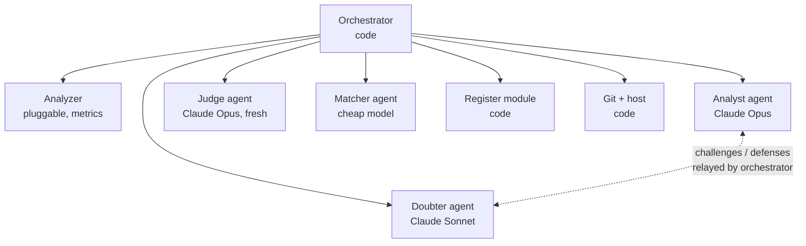

# SOLID analysis loop: design

Status: draft for review. Covers the analysis loop (analyze, debate, judge, update the technical debt register). The execution loop that changes code is out of scope except for the interface it will use.

## Contents
1. Decisions
2. Architecture
3. Run lifecycle
4. Agent roles
5. Handoff contracts
6. Guardrails
7. Technical debt register
8. Analyzer changes required
9. Failure handling and resumability
10. Configuration
11. Code layout
12. Deferred

---

## 1. Decisions

| Area | Decision |
|---|---|
| Scope | Codebase-agnostic. Nothing in the harness depends on a particular repo, branch name, or git host; repo specifics live in config |
| Orchestrator | TypeScript program on the Cursor SDK (`@cursor/sdk`), started manually: `npm run solid -- --repo <path>` |
| Analyzer | A pluggable step that produces findings in the metrics format. The first one is the C# SOLID analyzer from `evaluating-solid-principles` (needs the .NET 10 SDK); other languages add an analyzer, not harness changes |
| Runtime | Local agents against a checkout on the machine running the harness |
| Git host | GitHub through the `gh` CLI by default, behind a small host interface so GitLab or Azure DevOps can be added |
| Harness code | `agent-skills/harnesses/solid-loop/`. Run output never goes in this repo (it is public) |
| Run output | Committed in the target repo under `.tech-debt/` |
| Filing | Done by orchestrator code, never by an agent |
| Doubter scope | Dispositions, missed violations, severity, recommendations, process. Not thresholds |
| Doubter coverage | Every Critical/High decision, every dismissal, a sample of Medium/Low; at most 15 challenges per round, highest risk first |
| Evidence | Both sides cite `file:line` for every claim; a claim without evidence loses by default |
| Analyst responses | Concede, revise, or defend with new evidence |
| Rounds | Up to 3 rounds of challenge and defense; anything still disputed goes to a judge |
| Models (defaults) | Analyst: Claude Opus. Doubter: Claude Sonnet. Judge: Claude Opus with no prior context |
| Human gate | Every run ends as a pull request into the target repo's base branch; merging it is the approval |
| Register | One file per item plus a generated `TECH-DEBT.md`; execution agents can only claim a fix, a later analysis run confirms it |

## 2. Architecture



Code owns sequencing, validation, file layout, the register, and git. Agents only produce content that needs judgment. Agents never talk to each other directly and never write to `.tech-debt/`; the orchestrator relays each handoff after validating it.

**Analyzer contract.** An analyzer is any command that takes a repo path and writes a metrics file with `findings` (id, principle or category, criterion, type, file, line, value, severity, threshold, details), `stats.types_analyzed`, and `scoring`. Its config entry names the command, the skill whose `SKILL.md` and references the agents follow, and the id prefix it uses in the register (`solid-` for the SOLID analyzer).

**Host interface.** `push(branch)`, `createPullRequest({ repo, base, head, title, body })`, `defaultBranch(repo)`. The GitHub implementation uses `gh`; others implement the same three calls.

## 3. Run lifecycle

The run id is the UTC timestamp plus the short commit SHA, e.g. `2026-10-12T1633Z-1a2b3c4`. Each step records its completion in `manifest.json`, so a failed run can resume from the last completed step (section 9).

| # | Step | Who | Output |
|---|---|---|---|
| 0 | **Preflight.** Resolve the base branch (the remote's default branch unless `git.base_branch` is set); the checkout is clean and on it; fetch; check the push target (section 6); create branch `agent-runs/solid/<run-id>`; create a disposable worktree at that commit for the agents; confirm the configured models exist (`Cursor.models.list`) | code | `manifest.json` |
| 1 | **Analyze.** Run the configured analyzer (for SOLID: `solid-analyzer.cs analyze`) | code | `metrics.json` |
| 2 | **Carry forward.** Match findings to the register by stable id. Findings already `accepted` or `dismissed` are marked carried-forward and skip review, unless their severity rose | code | `carry-forward.json` |
| 3 | **Analyst review.** Review the remaining findings per the skill; add findings the metrics missed | analyst | `review.json` |
| 4 | **Debate**, up to 3 rounds: doubter challenges, analyst responds, orchestrator applies concessions and revisions. Stops early when no challenge is open | doubter, analyst | `debate/round-N.challenges.json`, `debate/round-N.responses.json` |
| 5 | **Judge.** Rule on challenges still open after the last round | judge | `verdicts.json` |
| 6 | **Assemble.** Merge review, responses, and verdicts into the final review; render the report | code | `final-review.json`, `SOLID-RISK-PROFILE.md` |
| 7 | **Reconcile.** Compute register changes. Match review-added findings to existing items (matcher), then apply the reconciliation rules (section 7) | code + matcher | `register-changes.json`, updated `.tech-debt/items/`, `TECH-DEBT.md` |
| 8 | **Propose.** Commit the run folder and register changes on the run branch, push to the target repo's remote, open a PR into the base branch with a summary of counts, new/resolved/reopened items, and every judged dispute | code | PR |

Merging the PR is the approval: the register on the base branch changes only when you merge. The execution loop reads the base branch only, so unapproved runs never become work.

The PR target repo and base branch are always passed explicitly (`git.pr_repo`, or the `origin` remote's repo when unset, and the resolved base branch). When the target is a fork, GitHub defaults PRs to the upstream repo, so the target is never left to the host's defaults.

## 4. Agent roles

The SDK does not load Cursor skills or settings by default (`settingSources: []`), so the orchestrator builds every prompt explicitly from versioned prompt files plus the skill's `SKILL.md` and `references/criteria.md`.

### Analyst (Claude Opus, one durable agent per run)

Created once with `Agent.create` and reused via `agent.send` for the review and every defense round, so it remembers its own reasoning.

- **Review:** follows step 3 of the skill. Writes `review.json` in the skill's existing format, with stable ids and `file:line` evidence on every decision.
- **Respond:** answers each challenge with one of:
  - `concede`: the decision changes as the doubter proposed.
  - `revise`: a different change (e.g. severity moves one level instead of being dismissed). Must say what changed.
  - `defend`: the decision stands. Must cite evidence not already given; repeating an earlier argument is rejected by validation and treated as a concession.

### Doubter (Claude Sonnet, one durable agent per run)

Durable across rounds so it remembers what it challenged and does not re-raise settled points.

- **Inputs:** the metrics, the analyst's review, the previous round's responses, and read-only access to the code in the worktree.
- **Challenge types:** `disposition` (keep/dismiss/adjust is wrong), `missed` (a violation nobody reported), `severity`, `recommendation` (unsound or not actionable), `process` (a skipped step or an unverified claim).
- **Coverage per round:** every Critical/High decision and every dismissal must be considered; Medium/Low are sampled. At most 15 challenges, ordered by risk. "Considered" does not mean "challenged": the doubter lists the items it checked and found sound, so coverage is auditable.
- **After round 1:** only challenges the analyst defended, plus new issues the defenses revealed. Conceded or revised items are closed.
- **Posture:** argue the strongest alternative, and propose a concrete outcome for every challenge ("dismiss DIP-004 because..."), never just "are you sure?".

### Judge (Claude Opus, fresh one-shot per run)

Started with `Agent.prompt` with no prior context, so it has not seen either side's reasoning develop. It receives only the open disputes: the original decision, every challenge and response, and the cited evidence. For each dispute it rules `upheld` (analyst stands), `overturned` (doubter's proposal applies), or `modified` (its own outcome), with a rationale and a confidence of `high`, `medium`, or `low`. It can read the code. A side that cited no evidence loses.

### Matcher (cheap model, one-shot, only when needed)

Metric findings match register items by stable id in code. Findings added during review have no fixed shape, so the matcher proposes, for each one, either an existing register item id or `new`. Code checks that every proposed id exists and is open or accepted. The matcher never decides status.

## 5. Handoff contracts

Every agent output is JSON, checked against a JSON Schema in `schemas/` before the orchestrator accepts it. On failure the orchestrator sends the agent the specific errors and retries up to 2 times, then fails the step.

All files carry `"schema_version"`. Shapes, abbreviated:

```jsonc
// debate/round-N.challenges.json (doubter)
{
  "schema_version": 1, "round": 1,
  "checked_and_sound": ["solid-7f3a9c", "solid-b21e04"],
  "challenges": [{
    "challenge_id": "R1-C03",
    "target": "solid-7f3a9c",              // finding id, or null for type "missed"
    "type": "disposition",                  // disposition | missed | severity | recommendation | process
    "claim": "InvoiceDocument is not a simple composite; it owns layout logic for 5 sections.",
    "proposed_outcome": { "action": "adjust", "severity": "medium" },
    "evidence": [{ "file": "src/Billing/InvoiceDocument.cs", "line": 50, "note": "Render() positions every section" }]
  }]
}

// debate/round-N.responses.json (analyst)
{
  "schema_version": 1, "round": 1,
  "responses": [{
    "challenge_id": "R1-C03",
    "response": "defend",                   // concede | revise | defend
    "argument": "Positioning sections is the layout responsibility itself.",
    "revised_outcome": null,                // required when response = revise
    "evidence": [{ "file": "...", "line": 12, "note": "..." }]
  }]
}

// verdicts.json (judge)
{
  "schema_version": 1,
  "verdicts": [{ "challenge_id": "R3-C01", "ruling": "modified", "outcome": { "action": "adjust", "severity": "low" },
                 "rationale": "...", "confidence": "medium" }]
}

// manifest.json (code)
{
  "schema_version": 1, "run_id": "2026-10-12T1633Z-1a2b3c4", "analysis": "solid",
  "repo": "owner/target-repo", "commit": "1a2b3c4...", "branch": "agent-runs/solid/2026-10-12T1633Z-1a2b3c4",
  "models": { "analyst": "...", "doubter": "...", "judge": "...", "matcher": "..." },
  "steps": [{ "name": "analyze", "status": "done", "finished_at": "..." }],
  "status": "proposed",                     // running | failed | proposed
  "pr": "https://github.com/..."
}
```

`register-changes.json` is the reconciliation plan (one entry per item: `add`, `update`, `propose-resolved`, `reopen`, `carry`). Code computes it, checks it, then applies it, so the plan and the applied result can be diffed in the PR.

## 6. Guardrails

- **Evidence is checked mechanically.** Every cited `file` must exist in the worktree and every `line` must be within the file. Failing citations are validation errors, so an agent cannot win with invented evidence.
- **Analysis agents cannot change code.** The SDK has no read-only mode, so all four agents run in a disposable worktree at the analyzed commit. Agents write their outputs to a scratch directory outside the worktree (an absolute path given in the prompt). After every agent run the orchestrator checks `git status --porcelain` in the worktree; any change is discarded, logged in the manifest, and fails the step.
- **No agent writes to `.tech-debt/`.** Only the register module does.
- **Pushes go only where config says.** Preflight checks that `origin` points to the configured `pr_repo` (or that `pr_repo` is unset). If an `upstream` remote exists, as in a fork, preflight requires its push URL to be disabled and refuses to run otherwise. The PR target is always passed explicitly.
- **Bounded cost.** Hard caps: 3 debate rounds, 15 challenges per round, 2 validation retries per step, and a per-agent-run timeout, all in config.

## 7. Technical debt register

```
<target repo>/.tech-debt/
  TECH-DEBT.md                      # generated: current debt, ratings, in progress
  items/solid-7f3a9c.json           # one file per item; the source of truth
  runs/solid/<run-id>/              # immutable history: manifest, metrics, review, debate, verdicts, report
```

### Item ids

The analyzer's prefix (`solid-` for SOLID) plus the first 6 hex characters of a SHA-256 over:
- metric findings: `principle|criterion|type full name`
- review-added findings: `principle|type|normalized title`, assigned once when the item is created and kept from then on; later runs reach it through the matcher

Line numbers and file paths are excluded because ordinary edits and file moves change them. On a hash collision, extend to 8 characters.

### Statuses

| Status | Set by | Meaning |
|---|---|---|
| `open` | analysis run | Confirmed debt |
| `accepted` | analysis run, with reason | Real, deliberately not fixing; carried forward |
| `dismissed` | analysis run, with reason | False positive; carried forward |
| `in-progress` | execution loop | Claimed: agent, branch, time |
| `fixed-pending-verification` | execution loop | Change made: commit recorded |
| `resolved` | analysis run | Finding absent in code that includes the fix |
| `reopened` | analysis run | A resolved item came back (treated as open) |

### Reconciliation rules (step 7)

| Item in register | Finding in this run | Result |
|---|---|---|
| none | present, kept | `add` as `open` (or `accepted`/`dismissed` per the final review) |
| `open` / `in-progress` / `fixed-pending-verification` | present | `update`: refresh severity, values, evidence, `last_seen_run` |
| `open` / `in-progress` / `fixed-pending-verification` | absent | `propose-resolved`: set `resolved` in the run branch; takes effect on merge |
| `accepted` / `dismissed` | present, same or lower severity | `carry`: no review, `last_seen_run` updated |
| `accepted` / `dismissed` | present, higher severity | re-enters review in step 3; outcome decides |
| `resolved` | present | `reopen` |

Every change appends to the item's `history` list (never edited), so each item tells its own story.

### Interface for the execution loop (later)

- Reads `.tech-debt/items/` on the base branch; picks `open`/`reopened` items by severity.
- Changes status only through the harness CLI: `claim <id>` and `mark-fixed <id> --commit <sha>`. Never edits the JSON directly.
- Cannot set `resolved`. The next analysis run does that.
- Compares the item's `last_seen_run` commit with the current code and re-checks the finding if the file has changed since.

## 8. Analyzer changes required

Changes to `evaluating-solid-principles/scripts/solid-analyzer.cs`:

1. **Stable ids.** Replace positional `SRP-001` ids with the hash ids above. The report keeps a short display label for readability.
2. **Carry-forward input.** `analyze --register <dir>` marks findings already `accepted`/`dismissed`, so the analyst skips them.
3. **Review format.** Accept stable ids in `reviewed`, and an optional `evidence` array on every decision.
4. **False-positive fixes from the first real-world run.** Count a class as a service only if one of its interfaces is used as a constructor parameter somewhere in the repo. Count only interface or service parameters as constructor dependencies. Count property access in LCOM.

The skill keeps working standalone; the harness uses the new options.

## 9. Failure handling and resumability

- **Startup failures** (`CursorAgentError`): retry only when `isRetryable`, with backoff; otherwise fail the step with exit code 1.
- **Run failures** (`result.status === "error"`): fail the step with exit code 2; the transcript id is logged in the manifest.
- **Validation failures:** up to 2 retries with the specific errors, then fail.
- **Resume:** `npm run solid -- --resume <run-id>` reloads the manifest and continues from the first step not marked `done`. Agents are recreated with their prior outputs in the prompt; conversation continuity across a crash is not required.
- **Logging:** `agent.agentId` and `run.id` are written to the manifest right after each `send`, before streaming.

## 10. Configuration

Three layers, later ones overriding earlier ones:

1. `harness.config.json` in the harness folder: defaults that apply to every repo.
2. `.tech-debt/config.json` in the target repo (optional): settings specific to that repo, committed alongside its register.
3. CLI flags for a single run.

```json
{
  "models": { "analyst": "claude-opus-5-5", "doubter": "claude-sonnet-5-5", "judge": "claude-opus-5-5", "matcher": "composer-2.5" },
  "debate": { "max_rounds": 3, "max_challenges_per_round": 15, "medium_low_sample_rate": 0.25 },
  "retries": { "validation": 2, "startup": 3 },
  "timeouts_minutes": { "analyst": 30, "doubter": 20, "judge": 15, "matcher": 5 },
  "git": { "host": "github", "base_branch": null, "pr_repo": null },
  "analyzers": {
    "solid": {
      "command": ["dotnet", "run", "{skill}/scripts/solid-analyzer.cs", "--", "analyze", "{worktree}", "--out", "{out}"],
      "skill": "../../evaluating-solid-principles",
      "id_prefix": "solid"
    }
  }
}
```

`base_branch: null` means the remote's default branch, and `pr_repo: null` means the repo `origin` points to. Model ids are checked against `Cursor.models.list` at preflight. Analyzer thresholds stay where each analyzer expects them (for SOLID, the target repo's `solid-thresholds.yaml`).

## 11. Code layout

```
harnesses/solid-loop/
  DESIGN.md
  package.json, tsconfig.json, harness.config.json
  prompts/              analyst-review.md, analyst-respond.md, doubter.md, judge.md, matcher.md
  schemas/              challenges, responses, verdicts, manifest, register-item, register-changes (JSON Schema)
  src/
    cli.ts              entry point: run, resume, claim, mark-fixed
    orchestrator.ts     step sequencing and manifest
    steps/              one module per lifecycle step
    agents.ts           SDK wrapper: create/send/prompt, timeouts, error handling, disposal
    validate.ts         schema checks plus evidence checks
    register/           ids, reconcile, apply, render TECH-DEBT.md
    git.ts              worktree, branch, commit
    hosts/              host interface; github.ts (gh CLI) first
    analyzers.ts        runs the configured analyzer command and checks its metrics file
```

## 12. Deferred

- The execution loop (agents that change code), beyond the register interface in section 7.
- Cloud runtime, scheduled or push-triggered runs.
- Doubter challenges to thresholds and config.
- Additional analyzers (other languages or other analysis types). The analyzer contract and per-analyzer id prefixes already allow them.
- Host implementations beyond GitHub.
- Cost reporting per run.
