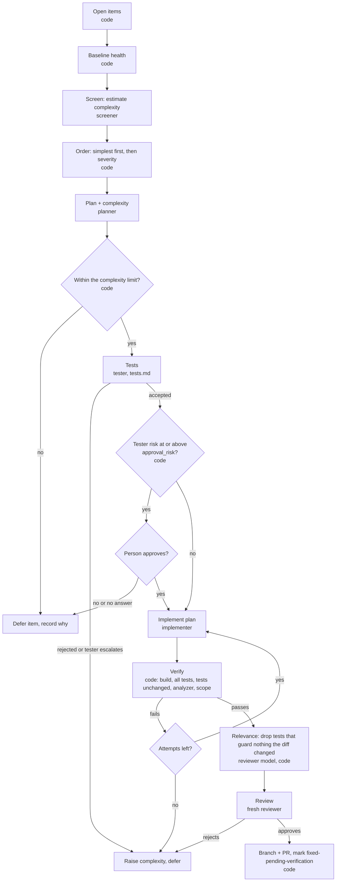

# Quality harness, refactor phase: design

Status: iteration 1 (dry run) done; iteration 2 (implementation) in progress, without the reviewer step yet. The second phase of the quality harness, alongside the analysis phase ([analysis.md](analysis.md)). It reads the register the analysis phase maintains (analysis.md, section 7) and shares the harness's agent wrapper, git, validation, register store, and config. Refactor-specific code lives in `harness/src/refactor/`, and each agent's prompts and schemas in its folder under `roles/` (screener, planner, implementer, tester, test-maintainer, auditor, coverage-reviewer, reviewer; the complexity rubric and refactoring vocabulary in `roles/shared/`). It runs as `npm run quality -- refactor --repo <path>` from `harness/`.

The analysis phase finds and confirms SOLID debt and records it in the register. The refactor phase takes one register item at a time and resolves it with a behavior-preserving refactoring, protected by tests written before the change. Three specialist agents do the work: a **planner** that plans the change, an **implementer** that applies the plan, and a **legacy-code tester** that builds the safety net. They are fully separated: the planner and the implementer have no responsibility for tests and never see them. This document covers the pipeline, the planner, and the implementer; everything about tests (the tester's role, test standards, test gates, and the test auditor) is in [tests.md](tests.md). Code orchestrates, gates, and verifies; agents only do work that needs judgment.

## 1. Principles

1. **Behavior is preserved, and that is proven, not assumed.** Every change is a refactoring in Fowler's sense: same observable behavior, better structure. The tester pins current behavior before any production code changes, and those tests must pass unchanged afterwards.
2. **Small and boring first.** Only Trivial and Simple items (levels 1 and 2) are attempted until the pipeline proves itself, and the simplest go first (section 6). The complexity limit is about risk, not cost. It is raised by evidence, and no agent can lower an item's complexity.
3. **Separation of duties, including information.** Tests are entirely the tester's responsibility. The planner and the implementer never write, read, choose, or run tests: their read tools cannot open test projects, they have no test-run tool, and the plan says nothing about testing. This avoids two problems: bias (an agent that sees the tests can shape the change to pass them rather than to preserve behavior) and context bloat (test code in their context they do not need). The tester never edits production code. A fresh reviewer checks the result. No agent judges its own work.
4. **The analyzer is the referee for "resolved", not the implementer.** A fix counts only when the finding disappears (or drops to the planned severity) without new findings on the touched types, and the next analysis run confirms it.
5. **Feathers' legacy code change algorithm, mechanized:** identify change points (planner), get them under test (tester), make the change (implementer), verify (code).

## 2. Flow



| # | Step | Who | Output |
|---|---|---|---|
| 0 | **Open items.** Read `.tech-debt/items/` on the base branch. Take `open`/`reopened` items, skipping items already deferred or escalated at the current complexity limit or a higher one, and items already in review: an open pull request from a `refactor/<id>-<run>` branch, or such a local branch that was never pushed. With `--item`, an item in review stops the run. Listing pull requests must succeed when pushing | code | `refactor-runs/<run-id>/manifest.json` |
| 1 | **Baseline health.** In a fresh worktree at the base commit: build the configured projects, run every configured test project, and re-run the analyzer. Record pre-existing test failures as the baseline; they never block a fix, new failures always do. Metric items the analyzer no longer reports are dropped | code | `baseline.json` |
| 2 | **Screen and order.** The screener estimates each remaining item's complexity (section 6.1). Items estimated above the limit are left for later; the rest are ordered simplest first, then by severity. Nothing is claimed in the register yet; step 0 keeps runs from repeating items in review. `--select` stops here: it skips the baseline test runs, writes the ranked candidates to `selection.json`, and prints an `--item` list. A person then chooses the items, and `--item a,b,c` runs exactly those, in that order, without screening (for example, the same items under two model configurations) | screener, code | `screening` in the manifest |
| 3 | **Plan.** The planner writes a plan with a complexity rating (section 4). Items whose file is test code go to the tester instead, which plans and refactors them itself ([tests.md](tests.md) section 7, case B) | planner | `plan.json` |
| 4 | **Gate.** Complexity is the higher of the planner's rating and the code-computed floor. Above the limit: defer and record why | code | `gate.json` |
| 5 | **Tests.** The tester receives the item and the plan and returns tests that passed its gates, or an escalation ([tests.md](tests.md)) | tester | test files, `tests.json`, `test-gates.json` |
| 5a | **Approval.** If the tester's risk is at or above `refactor.approval_risk`, wait for a person's `approval.json` ([tests.md](tests.md) section 3.7) | person | `approval-request.json`, `approval.json` |
| 6 | **Implement.** A fresh implementer with read, edit, and a `build` tool applies the plan in the sparse work tree, editing only the files the plan lists. Code rejects changes outside them, and outside the work tree. If the plan is wrong it reports `plan-wrong` instead of improvising | implementer | `implementation-<n>.diff` |
| 7 | **Verify.** Apply the diff to a full work tree, copy the tester's files in unchanged, run every test project (baseline failures excepted, the tester's tests must run and pass), re-run the analyzer, and check the diff stays inside the plan. A failure goes back to the implementer as production build errors and behaviors in plain words; `refactor.implement_attempts` (default 2) attempts. A broken build of existing test code stops the item as `tests-need-adapting` | code | `verify-<n>.json` |
| 7a | **Relevance.** After case C (tests.md section 7), a fresh agent asks of every test the PR would add: does it meaningfully check something that could have broken because of this diff? A `relevant` verdict must quote a changed line and the mistake in it the test would catch. Code removes the rest and re-runs the test projects; on any problem every test stays ([tests.md](tests.md) section 8) | reviewer model, code | `relevance.json` |
| 8 | **Review.** A fresh agent with no prior context reads the finding, plan, final diff, the implementer's deviations, and the tester's uncovered gaps, and rules `approve` or `reject`. It must cite where the problem is resolved. A rejection needs a blocking finding; it records `review-rejected`, raises complexity, and the item is skipped until the limit rises. Test-code items (case B) are reviewed too | reviewer | `review.diff`, `review.json` |
| 9 | **Propose.** Commit the fix on `refactor/<id>-<run>`. Then, in a second commit on the same branch, move the item to `fixed-pending-verification` (claim, then mark fixed with the fix commit and the branch). Only the item's own file changes; `TECH-DEBT.md` is shared by every item, so it is left for the next analysis run to regenerate, and refactor PRs never conflict with each other. Push and open one PR per item; the PR body says it changes the register | code | PR |

The human merge is the approval, as in the analysis phase: the register on the base branch changes only when a person merges the fix. A PR closed without merging leaves the base register untouched and releases the item for another run. The next analysis run on the base branch moves the item from `fixed-pending-verification` to `resolved`, or back to `open` if the finding is still there. Reopening after a bad merge is otherwise a person's job; this would change if merges became automatic.

## 3. Agents

All agents get the SDK's read-only built-in tools. Edits go only through harness tools whose callbacks check the path against the agent's allowed set before writing, so scope is enforced in code, not by the prompt. Nobody gets a shell: the orchestrator runs builds and returns the results through a tool, so every command is logged and bounded. Submissions go through submit tools with schema and semantic checks, as in the analysis phase.

### Screener (cheap model, fresh one-shot per item)

Estimates how complex the smallest real fix for an item would be, using the same rubric as the planner (section 4), so only items likely within the limit get a full plan. A few targeted reads, not a plan: does the abstraction already exist and is it registered, does it have every member the type uses, who constructs the type, and how many files and projects the change touches. Works in the same sparse worktree as the planner, without test code. Its estimate only decides which items are planned and in what order; the planner's plan and the computed floor still decide whether an item goes ahead, so a wrong estimate costs at most one planning run.

### Planner (Opus, fresh per item)

Specialty: refactoring legacy C# safely. It works from Fowler's refactoring catalogue and Feathers' dependency-breaking techniques, named explicitly in the plan so each step is reviewable. Reads the finding, the code, its callers, and the composition root, and writes `plan.json` (section 4). May not edit anything. The plan carries the judgment, so this role stays on the strongest model.

### Implementer (Sonnet, fresh per item)

Applies the plan. May edit only the production files listed in it, and has a `build` tool only. Must keep the code compiling between steps ("lean on the compiler"). If the plan turns out to be wrong, it submits `plan-wrong` with the reason instead of improvising, and the item's complexity is raised.

### No test contact (planner and implementer)

Both work in a sparse worktree (git sparse-checkout) that does not contain the configured test projects, so their built-in read, grep, and list tools cannot reach them. When verification finds a regression, the implementer is told which behavior regressed in plain words, taken from the `behavior` field of the tester's declaration (for example, "Details returns NotFound for an unknown id"), never the test name, code, or output. That is enough to find the mistake in its own change without seeing the tests.

### Legacy-code tester

A separate specialist, specified in [tests.md](tests.md). From this pipeline's side it takes the item and the accepted plan and returns either accepted tests or an escalation with a proposed complexity level. It never edits production code.

### Reviewer (Opus, fresh one-shot per item)

New agent, no prior context, like the analysis judge. Checks two things verification cannot:

1. **Behavior preservation:** anything in the diff that could change observable behavior (exception types, ordering, null handling, side effects, DI lifetimes).
2. **Real fix, not metric gaming:** the design problem is gone, not hidden from the analyzer (for example, `new` moved into a static helper to dodge `concrete_instantiations`, or a class split along lines that leave the responsibilities tangled). For items from review, which the analyzer cannot check, this is the only check before the person.

It also checks the diff where the tester said its tests do not reach, and whether each deviation from the plan was needed. Non-blocking findings go into the pull request body for the person. Prompt: `roles/reviewer/review.md`; schema: `roles/reviewer/review.json`; model: `models.reviewer`.

## 4. Plan and complexity

```jsonc
// plan.json (planner)
{
  "item_id": "solid-1a2b3c",
  "goal": "OrderController gets IOrderRepository from its constructor instead of creating OrderRepository",
  "resolution": { "criterion": "concrete_instantiations", "expected": "absent" },   // or { "expected_severity": "low" }
  "steps": [
    { "refactoring": "Parameterize Constructor", "source": "Feathers", "files": ["src/Web/OrderController.cs"],
      "detail": "Add IOrderRepository parameter; assign the field from it; delete `new OrderRepository(context)`" }
  ],
  "files": ["src/Web/OrderController.cs"],              // every production file the change may touch
  "public_surface_changes": ["OrderController constructor gains IOrderRepository"],
  "callers": [{ "file": "src/Web/Startup.cs", "line": 88, "note": "already registers IOrderRepository" }],
  "behavior_notes": "Same repository type at runtime (scoped registration); no change to action results",
  "change_points": [ { "type": "OrderController", "member": "Details(int)", "note": "only action that uses the repository" } ],
  "complexity": { "level": 1, "reasons": ["single type", "abstraction exists and is registered", "no public behavior change"] },
  "risks": ["DI lifetime differs from the manual construction"]
}
```

### Complexity levels

The screener and the planner both rate against this rubric, from `roles/shared/complexity-rubric.md`.

| Level | Meaning | Typical examples |
|---|---|---|
| 1 Trivial | One type. No signature change visible outside it, or only a constructor change whose only caller is DI. The abstraction already exists and is registered | Inject an existing registered interface instead of `new`; replace `DateTime.Now` with the existing clock abstraction |
| 2 Simple | One type plus its composition root, or a split inside one file. Callers are few and mechanical | Extract Method or a small private Extract Class; register an existing implementation |
| 3 Moderate | A new abstraction, or several types in one project | Extract Interface on a concrete dependency and inject it into its consumers |
| 4 Complex | Crosses projects, changes a widely used interface, needs dependency-breaking before the code can be exercised in isolation, or touches persistence mapping | Interface consumers in several projects; EF model changes |
| 5 Major | Reshapes a design across many types | Replace Conditional with Polymorphism across a duplicated switch |

### Computed floor

Code computes a minimum level from the plan and the code, and the effective level is the higher of the two:

| Signal | Floor |
|---|---|
| More than one production file, or any file in another project | 2, 3 |
| A new public type or interface | 3 |
| The change reaches files outside the plan: sites that construct a type whose constructor changes, or, for other public surface changes, files that use the type other than to register it. Found by a whole-word search of the full baseline work tree (test code included), plus any listed callers; Roslyn would be exact | 3, or 4 above `refactor.caller_threshold` (default 5) |
| Existing test files use what the plan changes (production plans; counted, never shown to the planner) | 2 |
| Touches an EF `DbContext`, entity configuration, or migration | 4 |
| Touches `async`, threading, or static mutable state | 4 |
| The tester escalated | the tester's proposed level |
| A failed implementation attempt | current level + 1 |

Agents can raise complexity. Nothing lowers it except a person editing the item.

## 5. Tests

Owned entirely by the tester and specified in [tests.md](tests.md): role, standards, gates, and the test auditor. This pipeline only hands over the item and the plan, receives accepted tests or an escalation, and in step 7 checks that the accepted test files are byte-identical after implementation.

## 6. The complexity limit

`refactor.complexity_limit` is the highest complexity level the refactor phase attempts. It is a risk control, not a cost cap: until the agents have a track record, only changes small enough to review at a glance are attempted. It starts at **2** (Trivial and Simple).

### 6.1 Selection: simplest first

Planning with Opus only to defer the item is wasted work, and the highest-severity items are rarely simple. So selection screens before it plans:

1. **Screen.** For each open item still reported at the base commit, the screener (section 3) estimates the complexity of the smallest real fix with the shared rubric (`roles/shared/complexity-rubric.md`). Estimates are cached per item, commit, and model in `refactor-screens.jsonl` in the work directory, so a re-run at the same commit screens nothing new.
2. **Filter.** Items estimated above the limit are not planned in this run. They are not recorded as deferred, so they are screened again once the limit rises.
3. **Order.** Lowest estimate first, then highest severity, then metric findings before review-added ones (metric findings can be re-checked deterministically).
4. **Plan and gate.** The planner plans the first items up to `--limit`, and the gate (step 4) decides with the plan's effective complexity, not the estimate.

`--item <id>` skips screening: a person chose the item, and the gate still applies.

### 6.2 Raising the limit

The harness keeps an outcomes log (`refactor-outcomes.jsonl`), one line per attempted item: screened, predicted, and final complexity, attempts, gate failures, reviewer verdict, cost, and whether the PR merged without changes. It reports a recommendation; a person changes the limit.

Proposed rule: raise the limit by one level after 5 consecutive items at the current top level that merged without human changes, with no item that broke a test outside the new ones. Any reverted or reworked merge resets the count.

## 7. Guardrails

- Everything from the analysis phase: worktrees, no pushes outside the configured remote, explicit PR targets, no agent writes to `.tech-debt/`.
- **File scope enforced by the tools:** the edit tool rejects paths outside the agent's allowed set; step 7 rejects a diff touching files outside the plan.
- **No package or project-file changes** in iteration 1, by either agent.
- **One item per branch and PR**, so each change is small and revertible.
- **Attempt limit:** 2 implementation attempts per item, then revert, raise complexity, release the claim, and record the reason in the item's history.
- **Staleness check:** if the item's file changed since `last_seen_run`, the analyzer must re-confirm the finding before planning.
- **Cost cap per item** in config; exceeding it stops the item and records it as deferred.

## 8. Toolchain

Legacy targets often cannot be built and tested with the current SDK as-is: new SDKs fail to compile old Razor views, and old EF Core versions break when rolled forward to a current runtime. The harness therefore runs builds and tests with an isolated `dotnet` folder outside every repo (an SDK that can still build the target, plus the target's original runtimes), and writes `global.json` only in its own work trees, never committed. The target repo and the machine's global .NET install are untouched.

```jsonc
"toolchain": {
  "dotnet_root": "%LOCALAPPDATA%/quality/dotnet",   // SDK 8 plus the target's runtimes, installed with dotnet-install
  "sdk": "8.0.425",                                    // written to global.json in the work tree only
  "env": {},
  "build": ["UnitTests/Unit.csproj", "IntegrationTests/Integration.csproj"],
  "test_projects": ["UnitTests/Unit.csproj", "IntegrationTests/Integration.csproj"],
  "skip_projects": ["FunctionalTests/FunctionalTests.csproj"]   // known not to restore or build
}
```

Preflight runs the baseline health check (step 1) and fails fast with a clear message when the toolchain cannot build or run the configured tests.

## 9. Recommended additions beyond the two agents

1. **Baseline health and a failure baseline** (step 1): pre-existing failures are recorded so they neither block fixes nor hide new breakage.
2. **Screening on a cheap model** (section 6.1): only items likely within the complexity limit get an Opus plan, simplest first.
3. **Fresh reviewer** focused on metric gaming and behavior preservation.
4. **Test-side checks** (sabotage, determinism, test auditor): see [tests.md](tests.md).
5. **Outcomes log and calibration report:** screened vs planned vs actual complexity, attempts, cost, merge result. This is how the complexity rubric gets tuned and how the limit is raised on evidence.
6. **Cost per item** in the manifest, using the same pricing table as the effort report.
7. **Metric findings before review-added ones** at the same estimated level: they can be re-checked deterministically. Review-added items need the analyst to confirm a fix.
8. **Dry-run mode:** plan and tests only, no implementation, to evaluate plan quality and tester behavior cheaply before letting agents change production code.
9. **Shared refactoring vocabulary:** a reference file listing the allowed refactorings and dependency-breaking techniques, with when each is safe. Plans must name steps from it, which makes plans comparable and reviewable.

## 10. Decisions

| Decision | Choice |
|---|---|
| Integration test runtime | The target's original runtime, installed in an isolated folder used only by this harness |
| SDK pin | `global.json` written in the work tree only, never committed |
| Location | The fix phase of the `refactor` skill, sharing the harness's modules, config, and register with the analysis phase |
| Test separation | Total: the planner and the implementer never read, write, choose, or run tests; the implementer learns about regressions only as plain-language behaviors. Test design lives only in [tests.md](tests.md) |
| Complexity limit | A risk control, not a cost cap. Starts at 2 (Trivial and Simple); config key `refactor.complexity_limit` |
| Selection order | Simplest first by screened estimate, severity as the tie-breaker, never above the limit |
| Screening | A cheap model (`models.screener`) estimates each item before any Opus plan; cached per item and commit |

## 11. Iteration plan

1. **Dry run (iteration 1):** open items, baseline health, screen and order, plan with complexity, gate, tests. No production code changes. Output: screening, plan, tests, gate results, and cost per item, for review by a person.
2. **Implementation:** approval, implement, verify, propose (branch, push, PR), within the complexity limit. Built. `--dry-run` still stops after the tests; `--no-push` commits on a local branch.
3. **Raise the limit** on the evidence in the outcomes log (section 6.2).
