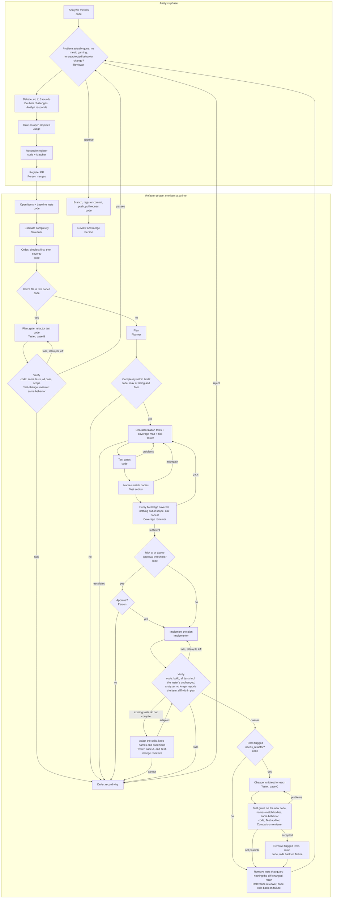

# Quality harness: agents and workflow

How the agents in the quality harness divide the work, from finding technical debt to opening a pull request that resolves it. Detailed designs: [analysis.md](analysis.md) (analysis phase), [refactor-phase.md](refactor-phase.md) (refactor phase), [tests.md](tests.md) (tests).

The harness has two phases. The **analysis phase** finds SOLID debt, argues about it, and records what survives in a register (`.tech-debt/items/`). The **refactor phase** takes one register item at a time and resolves it with a behavior-preserving refactoring, protected by tests written before the change.

A program, not an agent, runs both phases. It starts each agent, gives it only what its job needs, checks everything it submits, and decides what happens next. Agents only do work that needs judgment, and no agent judges its own work.

## Agents

Each agent's prompts and submission schemas are in its folder under `roles/`, named after its `models` key: `analyst`, `doubter`, `judge`, `matcher`, `screener`, `planner`, `tester`, `test-maintainer` (cases A and C), `implementer` (also applies case B plans), `auditor` (test auditor, test-change and comparison reviewers), `coverage-reviewer`, and `reviewer` (relevance and final review). `roles/shared/` holds what several roles read.

### Analysis phase

| Agent | Model | Responsibility | Can | Cannot |
|---|---|---|---|---|
| **Analyst** | Claude Opus, one per run | Reviews the analyzer's metric findings, keeps, dismisses, or adjusts each, and adds findings the metrics missed. Answers the doubter's challenges, and writes the final summary | Read the code | Change code; rule on its own disputes |
| **Doubter** | Claude Sonnet, one per run | Challenges the analyst's decisions, up to 3 rounds: severity, dismissals, missed violations. Must cite evidence | Read the code | Raise new targets after round 1; decide outcomes |
| **Judge** | Claude Opus, fresh for each run | Rules on disputes still open after the debate: upheld, overturned, or modified | Read the code and the evidence both sides cited | See how the debate developed beyond the disputes |
| **Matcher** | Composer (cheap), only when needed | Matches findings added during review to existing register items, or marks them new | Propose matches | Decide an item's status |

### Refactor phase

| Agent | Model | Responsibility | Can | Cannot |
|---|---|---|---|---|
| **Screener** | Composer (cheap), fresh for each item | Estimates each open item's complexity (1 to 5) so that only items likely within the complexity limit get a full plan | Read production code | See test code; change anything |
| **Planner** | Claude Opus, fresh for each item | Writes the refactoring plan: steps from a fixed vocabulary, files, callers, change points, behavior notes, risks, and a complexity rating | Read production code, in a checkout with no test folders | See, choose, or mention tests; change anything |
| **Tester** | Claude Opus, fresh for each item | Writes characterization tests that pin today's behavior and must pass unchanged after the refactoring, aimed only at what the plan's steps could break. Maps each way the change could break behavior (from the vocabulary's "Can break" notes) to tests, and rates the risk it leaves uncovered | Read everything; create new test files in the test projects; run tests | Edit production code, existing files, project files, or packages; see the implementation |
| **Test auditor** | Composer (cheap), fresh for each test file | Checks that each test's name and declared behavior match what its assertions actually check | Read the test file | Write or change tests |
| **Coverage reviewer** | Claude Sonnet (`coverage_reviewer`), fresh for each submission | Checks that every realistic way the change could break behavior is covered, that no test guards logic the plan does not touch, and that the risk rating is honest about the gaps | Read the code and the tests | Write or change tests |
| **Implementer** | Claude Sonnet, fresh for each item | Applies the plan step by step, keeping the build green. Reports `plan-wrong` instead of improvising | Read and edit production code, only the files in the plan; build | See, run, or change tests; touch files outside the plan |
| **Tester, refactoring test code** | Claude Opus plans; Claude Sonnet (`implementer`) applies; fresh for each item | For items whose file is test code (case B): plans the refactoring with the planner's schema, rubric, and vocabulary, then applies it | Read everything; edit only the plan's files, all of them test code; build; run tests | Edit production code, project files, or packages; add, remove, or weaken a test; rename one without declaring it |
| **Tester, adapting existing tests** | Claude Sonnet (`test_maintainer`), fresh for each item | When the refactoring changes a surface existing tests use and they no longer compile (case A): adapts how they build and call the code | Read everything, including the refactored code; edit existing test files that mention a changed type; build; run tests | Edit production code or its own characterization tests; rename, add, or remove a test; change an assertion line |
| **Tester, replacing expensive tests** | Claude Sonnet (`test_maintainer`), fresh for each item | After verification (case C): replaces each of its `needs_refactor` tests with a cheaper unit test that uses the seam the refactoring created | Read everything, including the refactored code; create new test files; run tests | Edit any existing file; remove tests itself (code removes them once replacements are accepted) |
| **Comparison reviewer** | Composer (cheap), fresh for each submission | Compares each expensive test with its replacement and says whether the replacement protects the same behavior | Read the code | Write or change tests |
| **Test-change reviewer** | Composer (cheap), fresh for each attempt | Compares the old and new version of every affected test and says whether each still verifies the same behavior | Read the code | Write or change tests |
| **Relevance reviewer** | Claude Opus (`reviewer`), fresh for each item that passes verification | Asks of every test the pull request would add: does it meaningfully check something that could have broken because of this diff? Each `relevant` verdict must quote a changed line and the mistake in it the test would catch; code removes the rest | Read the refactored code | Write or change tests (code does the removal) |
| **Reviewer** | Claude Opus, fresh for each item that passes verification | Reads the item, the plan, and the final diff, and decides whether the design problem is actually gone rather than hidden from the metric, and whether the diff changes behavior the tests would miss. Its approval, evidence, and findings go into the pull request; a rejection stops the item | Read the refactored code | Change anything; see earlier agents' conversations |

### People and code

| Actor | Responsibility |
|---|---|
| **Person** | Approves or declines an item before implementation when the tester's risk is at or above `refactor.approval_risk` (default medium). Reviews and merges the pull requests from both phases. Accepts debt that should stay (`accept <id>`) |
| **Code (the orchestrator and its gates)** | Everything that can be checked without judgment: baseline test health, ordering, the complexity floor, the test gates (build, green, determinism, sabotage, scope, survival, coverage map consistency), the approval pause, verification (build, all tests, analyzer), scope checks, commits, pushes, and pull requests |

## Workflow



### One item, as a conversation

```mermaid
sequenceDiagram
    autonumber
    participant C as Code (orchestrator)
    participant S as Screener
    participant RP as Planner
    participant T as Tester
    participant A as Test auditor
    participant CR as Coverage reviewer
    participant P as Person
    participant RI as Implementer
    participant RR as Relevance reviewer
    participant R as Reviewer

    C->>C: Baseline: run every test project, run the analyzer
    C->>S: Item + production code
    S-->>C: Complexity estimate
    C->>RP: Item, criteria, refactoring vocabulary, complexity rubric
    RP-->>C: Plan (validated by code)
    C->>C: Complexity gate (agent rating vs computed floor)
    C->>T: Item + plan (never the implementation)
    loop Until accepted (at most 6 rejections)
        T->>C: Tests, coverage map, risk
        C->>C: Static checks, build, green, 3 runs, sabotage
        C->>A: Each test file
        A-->>C: Name and behavior match the body?
        C->>CR: Plan, tests, coverage map, risk
        CR-->>C: Sufficient, or gaps
        C-->>T: Problems to fix, or accepted
    end
    alt Risk at or above the approval threshold
        C->>P: approval-request.json (goal, tests, gaps, risk)
        P-->>C: approval.json
    end
    C->>RI: Item + plan + allowed files (no tests)
    loop Up to 2 attempts
        RI->>C: Implementation (code checks scope and build)
        C->>C: Verify in a full checkout with the tester's files unchanged
        opt Existing tests no longer compile (case A)
            C->>T: Build errors + the test files that use a changed type
            T->>C: Adapted calls (code checks names and assertion lines, Test-change reviewer compares bodies)
            C->>C: Verify again with the adapted tests
        end
        C-->>RI: On failure: build errors and behaviors in plain words, never test code
    end
    opt Tests flagged needs_refactor (case C)
        C->>T: Flagged tests + the refactored code
        loop Until accepted
            T->>C: One cheaper unit test per flagged test, or not possible
            C->>C: Gates on the new code, Test auditor, Comparison reviewer
        end
        C->>C: Remove replaced tests, rerun; roll back on failure
    end
    C->>RR: Plan, production diff, final tests
    RR-->>C: Per test: the changed line it guards and the mistake it catches, or irrelevant
    C->>C: Remove irrelevant tests, rerun; roll back on failure
    C->>R: Item, plan, final diff, deviations, uncovered gaps, removed tests
    R-->>C: Approve (with where the problem is resolved), or reject with blocking findings
    C->>C: Commit plan files + tests on a branch, then the register change; push
    C->>P: Pull request (plan, tests, risk, verification, review)
```

## Separation rules

- **The planner and the implementer never see tests.** Their checkout has no test folders. They have no test tool, the plan may not mention testing, and on a regression the implementer learns only the behavior that broke, in plain words. This keeps them from shaping the change to pass tests instead of preserving behavior.
- **The tester writes its characterization tests without seeing the implementation**, and never edits production code. Those tests must run unchanged on the refactored code. It reads the refactored code only after verification, for two narrow jobs: adapting existing tests whose calls no longer compile (case A), and replacing its own `needs_refactor` tests with cheaper ones (case C). Code checks both jobs, and a reviewer confirms each test still verifies the same behavior.
- **Every judgment is checked by someone else.** The doubter checks the analyst, and the judge settles their disputes. The auditor and the coverage reviewer check the tester before the change, and the relevance reviewer checks its tests against the actual diff after it. Verification, the analyzer, and the reviewer check the planner and the implementer. A person checks the risk and the final diff.
- **Agents rate; code decides.** The complexity used is the higher of the agent's rating and a floor computed from the plan. A tester may raise complexity but never lower it. Only code changes register status and git state, and only people accept debt or merge.

## Not built yet

- **A source of test-code items.** Case B is built, but the SOLID analyzer skips test projects, so test-code items are added by hand until a test-smell analysis exists.
